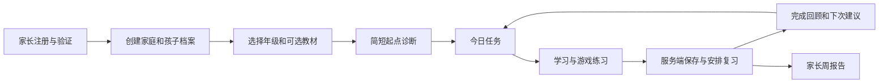

# 用户流程与页面设计

## 信息架构

儿童区主导航五项：探险地图、今日任务、专题特训、复习花园、我的发现。家长区独立拥有孩子、学习报告、课程设置、AI 服务与语音、家庭与隐私。内容编辑走独立成人入口。

路由建议：`/welcome`、`/choose-child`、`/learn/map`、`/learn/today`、`/learn/session/:id`、`/learn/review`、`/learn/collection`、`/parent/children`、`/parent/reports/:child`、`/parent/curriculum/:child`、`/parent/ai`、`/parent/privacy`。

## 关键流程

首次启动先让家长完成成人操作，孩子之后只看到图文大按钮。诊断可跳过，跳过即从所选年级建议起点开始，之后由练习修正。AI 不在首次使用的阻塞路径上。

## 页面规格

| 页面 | 首要问题与主操作 | 核心元素 | 空态或失败 |
| --- | --- | --- | --- |
| 档案选择 | 我是谁；选择自己的头像 | 昵称、头像、继续位置；不展示家庭邮箱 | 无档案时仅成人可创建 |
| 探险地图 | 接下来去哪；继续今日任务 | 年级/学期、6 单元路径、2D/3D 切换、当前节点 | 地图失败用 DOM 单元列表 |
| 今日任务 | 今天做多少；开始约 10 分钟 | 新学/复习/应用三段、可结束标记 | 零到期时“记得不错，试试新任务” |
| 专题中心 | 我想补哪一项；选专题或小诊断 | 8类60专题、建议年级、弱项、层级与复测 | 没有先修则推荐补基础，未开放层级明确说明 |
| 固定句式馆 | 什么场景用哪种表达；看句框后练应用 | 12主题72句式、固定部分、可替换词块、易混对比与对话 | 合法变体不判错；已展示例句不作独立迁移证据 |
| 专题训练 | 此次练哪个难点；完成一小轮 | 语法构句、时态时间线、词形输入等不同交互 | 用提示不算独立掌握；可退出后恢复 |
| 词汇练习 | 听懂并用出；听音后选图 | 图、音、英文、按需中文、可重听 | 音频失败允许文字替代，不计听辨成绩 |
| 句子工坊 | 怎样组成句子；放入词块并检查 | 大词块、句槽、朗读、提示、撤销 | 拖动失败用点击词块添加；键盘按钮同等可用 |
| 故事任务 | 理解意义；读/听后回答 | 短文分段、逐句朗读、问题独立区 | 文字永远可读，装饰不遮挡 |
| 说一说 | 轮到我说；按住或点击开始说话 | 麦克风状态、计时、停止、转写确认 | 拒绝权限后可打字或跳过，不判错 |
| 完成回顾 | 我学会了什么；结束 | 2–3 项具体收获、待巩固项、下次复习 | 保存中显示待同步，不虚报已云端保存 |
| 复习花园 | 哪些记忆需照顾；开始一小轮 | 推荐轮次与预计时间、按能力分组 | 积压分小轮，避免满屏红色警告 |
| 我的发现 | 我能做什么 | 作品、收藏词、已获得装饰、能力里程碑 | 不用钻石购买学习入口 |
| 家长报告 | 孩子需要什么帮助 | 独立正确、提示率、延迟表现、建议行动 | 样本少明确“还需观察” |
| 课程设置 | 跟什么进度；选择路线 | P1–P6、学期、教材版次与验证状态 | 未验证映射不显示“已同步教材” |
| AI 设置 | 接哪家、能做什么；保存并测试 | baseURL、密钥、模型、文本/语音独立卡、限额 | 401/429/超时/协议不兼容逐项说明 |

## 学习页布局

桌面：左侧窄导航，中央最大约 880 px 答题区，右侧小型任务信息；正文和答案不随 3D 镜头移动。平板横屏采用两栏，收起次要信息；竖屏单栏，底部最多五项导航。输入英文或弹出软键盘时答题操作滚入可视区域，不能被吸底条遮住。

题目上方仅保留退出、题目进度、声音开关；中间是题干和交互；底部是一个主要提交操作与次要提示。成人入口弱化但可发现；不能依赖长按或一道算术题作权限保护。

## 状态与反馈

每个异步动作有 idle/loading/success/error；AI 解释另加 unavailable 和 cancelled。答题提交后按钮立即显示“保存中”，收到服务端确认才显示“已保存”；网络失败保留原答案并支持重试。

正确：具体反馈“你为 They 选对了 are”，轻短角色动作。错误：先指出可改进的一处，保留操作结果，显示提示，不以红屏、震动或大音效惩罚。连续错三次改为示范，之后换题，不循环要求猜。

自动音频只在用户主动开始音频活动后启用；全站有静音开关。录音必须主动触发，每次 20 秒上限，退页面、锁屏或切孩子即停止并释放轨道。

## 可点击概念稿

专题新增路由 `/learn/training`、`/learn/training/:topicId`。详情页依次呈现目标、先修、3–5题诊断、推荐层级、当轮表现和延迟复测；实际练习复用学习播放器。概念稿另含语法选择、时态时间切换与词形输入，均为离线示例。

[概念稿](../prototype/index.html) 包含探险地图、句子工坊、复习、家长 AI 设置的演示路径，展示 PC/平板布局、即时反馈、2D 地图和减弱动效。它是离线 HTML 视觉验证工具，地图为 SVG 概念表达，生产 3D 的镜头与资产在后续 R3F 样片验证。
