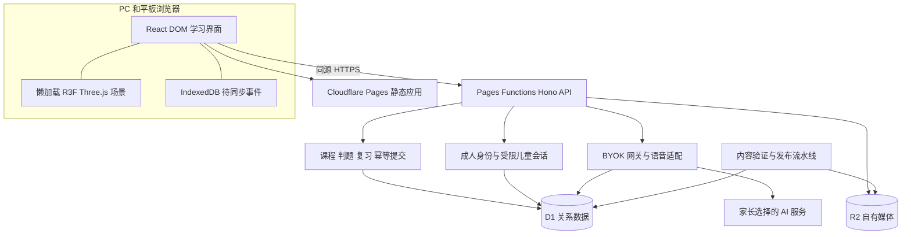

# Cloudflare 技术架构

采用 React 单页应用和同源 API。静态资源由 Pages 托管，`/api/*` 交由 Pages Functions，业务与答案在服务端。每种游戏实现统一的题目接口，不把课程规则写进场景。

## 系统分工



## 模块与目录建议

```text
apps/web/src/
  app/                 路由、权限、错误边界
  features/learning/   课程播放器和任务状态机
  features/games/      各题型 DOM 实现
  features/review/     队列与记忆展示
  features/parent/     家庭、报告、AI 设置
  world/               R3F 地图与角色，独立 chunk
  sync/                离线事件、重试和儿童缓存隔离
functions/api/          Pages 文件路由入口
packages/domain/       知识点、判题、复习的纯逻辑
packages/contracts/    API 与内容 Zod schema
packages/server/       Hono、授权、存储与 AI 适配器
packages/content/      原创课件、私有答案、版本清单
migrations/            D1 迁移，按环境执行
workers/maintenance/   后续定时清理、异步工作
```

这是完整产品的建议目录。M0已在根目录src与packages/functions等模块建立真实工程并锁定依赖，当前状态见 [开发计划](19-development-plan.md)。后续按模块规模再拆分apps/web；React/R3F/Three仍须真实平板样片验证，不把构建成功视作帧率通过。

## 客户端边界

专题中心增加`features/training`，复用`features/learning`播放器和题型渲染器。专题目录、错因推荐、phase与题目家族分配由服务端管理；不为每个专题开发独立应用或另建一套进度库。

用 React DOM 管理题干、输入、可访问状态和焦点；使用题型状态机 `ready → answering → submitting → feedback → next`。Zustand 或 Context 仅管理学习活动的本地状态；服务器数据由 TanStack Query 管理，query key 必须包含家庭和孩子。

Three.js 接收完成/错误/解锁等事件，只更新表现；帧循环不调用 React setState 更新业务进度。暂停、卸载、WebGL context lost 均不丢答案。可用 `frameloop=demand` 和资源复用减少无用渲染。[R3F 性能指南](https://r3f.docs.pmnd.rs/advanced/scaling-performance)

## 后端边界

Hono 中间件依次处理请求 ID、请求体限制、会话、家庭授权、CSRF/Origin、限流与 schema 校验，再进入服务。读 API 不返回答案、密钥或其他孩子数据。前端传入的年级、正确性、得分和 household_id 不能直接信任。

内容发布为不可变 release，活动会话固定 release。判题先支持确定性题型；开放表达输出建议，不作为唯一升级依据。所有进度、奖励、复习变更从已保存的 attempt 派生。

学习提交用 D1 原子 batch；每次先按预期版本更新儿童学习流版本，SQL 断言确保更新行数为 1，再提交 attempt、card、奖励和收据。零行 CAS 必须让整个 batch 失败并重试，不能在 batch 已提交后才发现冲突。此实现方式是阶段 S0 的必测技术项。

## 存储选择

| 产品 | 首发职责 | 不承担的职责 |
| --- | --- | --- |
| D1 | 家庭、档案、内容元数据、事件、复习、密钥密文、用量 | 音频大文件和视频 |
| R2 | 原创标准音频、图片、可下载导出、加密备份 | 默认长期保存儿童录音 |
| 浏览器 IndexedDB | 本设备已授权孩子的已下载题目和待同步事件 | 主进度源或长期密钥存储 |
| KV | 首发可不启用；后续缓存非敏感配置 | 精确限额、事务、当前会话权限 |
| Durable Objects | 后续实时语音状态或高并发预算串行化 | 首发所有业务的必需品 |

首发精确限额在 D1 中预留与结算，不用 KV 做严格计数。如果需要定时删除和报告预计算，单独部署维护 Worker；Pages 请求函数不是可靠后台任务队列。异步 AI 生成采用可追踪任务；队列和失败重试需要时再启用，不为了架构完整感预先添加。

## 部署与环境

本地使用 Wrangler 模拟 D1/R2，保留 SQLite 单元检查；Preview 与 Production 分别绑定独立 D1、R2、认证回调和密钥，预览不能访问生产儿童数据。Pages 构建 `apps/web` 输出，显式 `_routes.json` 只将 `/api/*` 纳入 Functions；实际文件与重写由路由烟测验证。[Pages Functions 路由](https://developers.cloudflare.com/pages/functions/routing/)

环境秘密：认证 secret、密钥加密主密钥及 key id、可选邮件服务凭据。不得使用 `VITE_*` 注入秘密。数据库迁移先预览演练，随后生产向前迁移；前端与 API 至少兼容一个旧 release，避免平板旧缓存无法同步。

## 缓存、备份和运行

公开自有媒体按内容 hash 长缓存；含家庭数据的 API 使用 `private, no-store`。Service Worker 仅缓存静态 shell 与已下载公开课件，不缓存 `/api/parent`、AI 响应、token 和解密后的密钥。登出清理设备级儿童缓存，明确提示未同步事件处理。

每日加密导出关键数据，按 30 天滚动保存；恢复演练目标 RPO 24 小时、RTO 4 小时，为自定运营目标。D1 自带恢复窗口只是补充，不能替代跨版本恢复与误删演练。监测错误码、保存耗时、行读写量、AI 超时、配额拒绝；日志使用不含题目原文和儿童文本的结构化字段。

访问地区和模型可达性须实测。Cloudflare 全球网络不能保证任何特定地区的稳定体验，也不能保证 D1、日志和第三方 AI 只在某地区处理数据。
