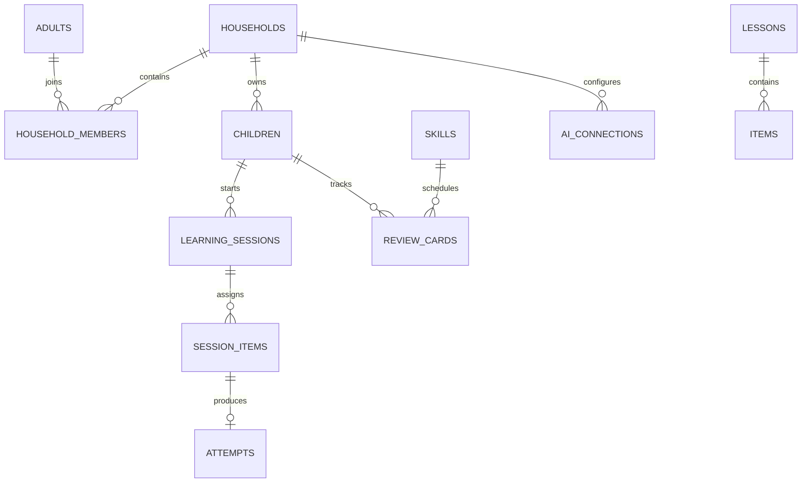

# 学习数据模型与一致性

## 模型关系

## 核心实体

| 实体 | 关键字段 | 约束 |
| --- | --- | --- |
| adult | auth_subject、email_verified | 身份由认证库处理；业务表只引用成人身份 |
| household/member | household、adult、role | 一个家庭至少保留一位 owner；邀请需时效和一次性令牌 |
| child | household、nickname、grade、timezone、locale | 不采集真实生日、学校、地址；档案不直接等于认证账号 |
| child_grant | device token hash、child、expires、revoked | 仅当前孩子学习权限；家长区重新验证 |
| skill/prerequisite | stable id、kind、dimension、dependency | 图谱不得有硬依赖环 |
| lesson/item | id、version、release、objectives、payload、answer | ID 稳定，版本不可变；答案仅服务端读取 |
| textbook/mapping | 系列、版次、册、单元、技能、status | 未审核映射不能标记已验证 |
| learning_session | child、release、lease、state | 活动时固定内容版本；接管后旧 lease 不再产生奖励 |
| session_item | assignment id、position、item_version、primary skill | 独立 assignment，不接受前端随意指定答案 |
| attempt | event id、assignment、answer、outcome、hint、server seq | 每个 assignment 最多一条首答证据；重试返回原收据 |
| review_card | child、skill、modality、stage、due、version | 一个孩子一个技能维度只有一行 |
| reward_ledger | child、source attempt、delta、reason | source 唯一，重放不重复奖励 |
| ai_connection | household、base URL、model、ciphertext、key id | 仅授权成人可管理，不明文输出 |
| usage_reservation | household、request id、reserved、actual、state | 请求幂等，先预留、后结算；未知结果不自动全额退款 |
| consent/audit | household、actor、purpose、version、time | 权限与录音同意可撤销，审计不存密钥或原音 |
| deletion_job | scope、state、backup cutoff、receipt | 可追踪主库、R2、缓存和供应商清理 |

可执行的核心草案见 [schema.sql](specs/schema.sql)。它覆盖重要关系与约束；认证库、自助邀请、教材编辑工作流等在实际开发阶段生成补充迁移，不能把该草案称为完整生产数据库。

## 隔离规则

专题增量包含`training_topics`、`topic_skills`、`topic_items`、`training_runs`与`word_forms`，句式馆另有`sentence_patterns`和`topic_patterns`；详见 [专题设计](17-topic-training.md) 和 [句式设计](18-sentence-patterns.md)。专题引用现有item版本与skill；run保留家庭/孩子/会话的复合外键，答题仍进入attempts与review_cards。词形库按lemma与form区分规则及例外，句式库按固定部分/槽位/语境/变体建模，不能只在AI提示词里约定。

所有家庭私有记录包含 household_id，涉及孩子的复合外键校验 `(household_id, child_id)`。服务器先从可信会话解析家庭，再查成员角色或受限儿童 grant，最后使用带家庭条件的查询；查询层不提供缺省“查全部家庭”的方法。

D1/SQLite 没有可直接假设存在的 PostgreSQL 风格行级权限保护。隔离依赖应用授权、复合外键和对抗测试共同保证；猜到 UUID 不应获得读取能力。管理员后台也不能把超级权限用于普通学习 API。

## 时间与版本

数据库时间使用 UTC 毫秒整数，报告和日程在 IANA 时区转换。儿童时区默认为家庭设置（初始 Asia/Shanghai），变更只对未来日程生效，最多每天修改一次，不能借改时区刷奖励。

不可变事件记录 server_seq、received_at、client_occurred_at、algorithm_version、content_release。报告可从事件重建；缓存汇总有 projection_version。只改题干不覆盖旧版本，否则旧答题无法重现。

## 幂等事务

1. 校验 grant、家庭与 assignment，若 event 已存在则返回原收据；若 assignment 已答则返回已有结果。
2. 读取儿童学习流与 card 版本，在内存计算确定性结果。
3. 一个 D1 batch：CAS 更新学习流 → 插入带 `CHECK(ok=1)` 的提交断言 → attempt → card → 奖励 → response receipt。
4. CAS 失败引发断言错误，整批回滚，最多重新读取后重试 3 次；仍冲突返回 409，可重试且不新建 event id。

断言必须紧接 CAS，以 SQLite `changes()` 读取该语句影响行数；D1 支持和并发行为在本地/远程 S0 验证，不以普通 SQLite 检查替代。若远程验证不通过，改为每孩子 Durable Object 串行提交，增加独立 Worker，不能上线有部分提交风险的实现。

CAS 的 WHERE 条件同时验证家庭、预期版本、当前有效lease、未撤销且未到期的grant；不能只在事务前检查一次授权，否则并发接管或撤销可能仍写入进度。草案SQL定义的是存储约束，完整提交语句在S0实现并验证。

## 索引与保留

常用索引：`children(household_id)`、`attempts(household_id, child_id, received_at)`、`review_cards(household_id, child_id, due_at)`、`ai_usage(household_id, created_at)`。统计按日汇总，不能首页全扫 attempt。索引也增加写量，按实际 `rows_read/rows_written` 调整。[D1 计费定义](https://developers.cloudflare.com/d1/platform/pricing/)

建议原始答题记录保留 12 个月，之后只留家庭内聚合；AI 文本默认不留原文，用量 90 天；原音默认仅请求内处理；撤销会话与审计保留 90 天。家长可提前删除，精确保留与法定要求需在选定运营地区后核对，详见隐私设计。

## v0.31已实现的家庭协作

0032在account_sessions增加当前家庭、上下文版本与切换命令；家庭成员继续使用原复合键，不复制儿童或学习数据。household_access保存全家庭权限版本与事务许可；household_invitations保存接收者、邀请人、角色、令牌摘要、到期及接受/撤销状态；household_membership_audit仅记账号引用、操作和时间。0033增加`household_members(adult_id,household_id)`覆盖索引，限制认证与成员计数读量。

权限变更与审计在同一batch提交，角色调整/移除同时撤销目标账号所有会话和grant；成员与版本读取也使用一致batch。无家庭成人的当前上下文显式为空，保留登录与重新受邀能力。邀请码只以摘要存储，原码不进日志、URL或公共缓存。此阶段不实现账户删除、保留期清理或备份恢复，不能把成员移除等同于成人数据删除。实际字段、接口与检查见[家庭协作记录](52-household-invitations-and-roles.md)。
